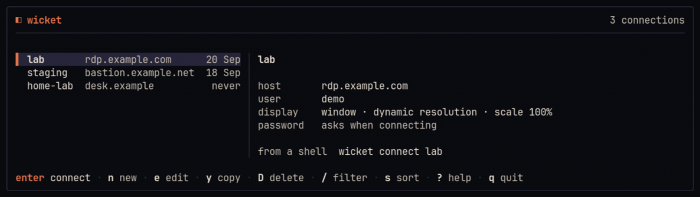
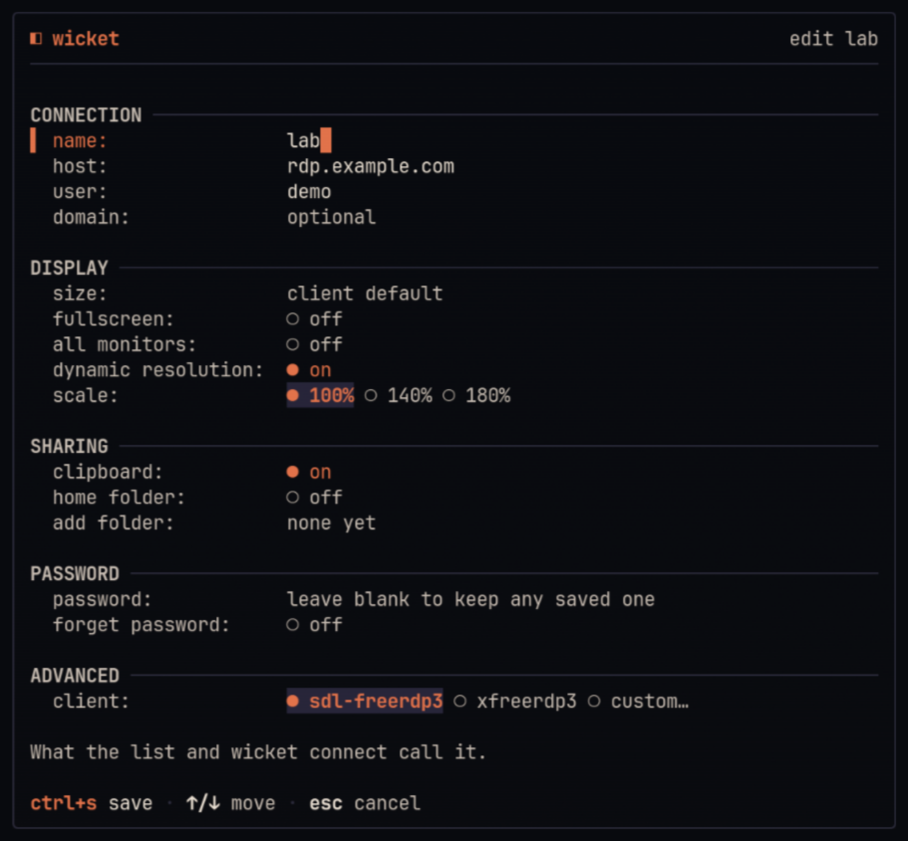
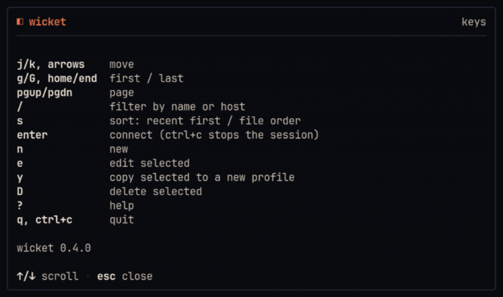

<p align="center">
  
</p>

# Wicket

Terminal UI for FreeRDP connections. Pick a profile, connect, come back
when the session ends.



<p>
  
  
</p>

## Platform

Linux and macOS. Passwords go in the Secret Service keyring
(`org.freedesktop.secrets`) on Linux, and in the Keychain on macOS.
Windows does not build.

## Install

```
curl -fsSL https://raw.githubusercontent.com/gaius-codius/wicket/main/install.sh | sh
```

This installs the latest release for amd64 or arm64 into `~/.local/bin` (set
`WICKET_BINDIR` to change it) after checking it against the release's
`SHA256SUMS`. Run the same command again to update.

It downloads with `curl`, or with `wget` where there is no `curl`: GNU Wget
1.x, Wget2 or busybox, each held to https through every redirect and made to
check certificates whatever `~/.curlrc` or `~/.wgetrc` says. Any other `wget`
is refused. Busybox checks certificates only through `openssl`, and only
since 1.33; without `openssl` on `PATH` it uses TLS of its own that checks
nothing, and with `http_proxy` set it sends https requests to the proxy
unencrypted. Either way anyone between you and GitHub could hand it a
release, so the installer refuses an older busybox, one without `openssl`,
or one behind `http_proxy`, and asks for `curl`.

```
... | sh -s -- --version v0.1.0   # a given release
... | sh -s -- --uninstall        # remove the binary
```

Releases after v0.3.1 carry a signed build provenance attestation. When the
[GitHub CLI](https://cli.github.com/) 2.68 or newer is installed, logged in or
not, the installer checks it with `gh attestation verify` and refuses a
download the release workflow did not build, or one it could not check because
GitHub was unreachable or rate limited. When `gh` is missing or older, it says
the check was skipped and installs anyway. v0.1.0 to v0.3.1 predate attestations;
the installer checks those against digests it carries itself. To check a
download yourself:

```
gh attestation verify wicket_<version>_<os>_<arch>.tar.gz --repo gaius-codius/wicket \
  --cert-identity https://github.com/gaius-codius/wicket/.github/workflows/release.yml@refs/tags/v<version>
```

Config, state, and keyring entries are never touched. Or, with Go:

```
go install github.com/gaius-codius/wicket/cmd/wicket@latest
```

Needs a FreeRDP 3 client on `PATH`. New profiles use the first one found:

1. `sdl-freerdp3`, then `sdl-freerdp`
2. `xfreerdp3`, then `xfreerdp`

Linux packages usually install the names with a `3` suffix. A name without
it counts only when its `--version` reports FreeRDP 3, so a FreeRDP 2
`xfreerdp` is passed over.

### macOS

Homebrew's `freerdp` formula installs the same clients
without that suffix:

```
brew install freerdp
```

That puts `sdl-freerdp` and `xfreerdp` on `PATH`. Wicket discovers and offers
those names the same way as `sdl-freerdp3` and `xfreerdp3`. A new profile
uses `sdl-freerdp` when that is the first of the list above that exists.

## Run

```
wicket                 # TUI
wicket connect work    # named profile, no TUI
wicket import remmina  # from ~/.local/share/remmina
wicket import rdp FILE...
wicket export rdp work # to work.rdp; --all for every profile
wicket --help
wicket --version
```

`wicket connect` is for keybindings and scripts. It does not create a config.
On a non-TTY there is no password prompt, so save the password from the TUI
first. If the keyring cannot be reached, connect says so and exits; on a
terminal it asks for the password for that connection and does not offer to
save it. A locked keyring shows its unlock prompt. If that unlock is
refused, dismissed or left unanswered, connect says the keyring is locked:
off a terminal it exits, and on a terminal it asks for the password for that
connection and does not save it. The TUI does the same, and a save from the
TUI against a locked keyring also asks to unlock it; when the unlock is
refused, the password is not saved and the TUI says why. A saved password it
cannot use, such as one over 511 bytes (the most FreeRDP accepts), is
reported and connect exits; save a new one from the TUI.
Press `?` in the TUI for keys and field help.

`wicket import` brings Remmina (`*.remmina`, RDP only) or Microsoft `.rdp`
files into wicket profiles; `wicket export rdp` writes them back out (see
below). There is no sync.
A turned-off clipboard, all monitors (`use multimon`) and shared folders come
across. "All drives" (`*`,
`DynamicDrives` in an `.rdp` file), Windows drive letters, the home folder
(`%`, `~`), any folder that holds it, such as `/home` or `/`, and anything
under `/proc` do not, nor does a folder with a link in it that leads to one
of those; turn on `share_home` yourself if you want home shared.
Nor does a relative path, or a folder a config could not hold, such as a
path with a comma or a control character in it, or a second folder shared
under the same name. The summary names each folder left out and why.
Passwords are never imported; you enter them on first connect. A file with
no username imports with none, and the TUI asks for one when you connect;
`wicket connect` refuses it until one is set. Use
`--dry-run` to preview, and `--rename` to append `-2`, `-3`… on name
collisions (otherwise collisions are skipped). It exits 1 when entries were
found but none was imported.

`wicket export rdp PROFILE...` (or `--all`) writes each profile to an `.rdp`
file that Windows Remote Desktop and FreeRDP open, named after the profile
with anything unsafe in a file name turned into `_`. It carries the host,
user, domain, size, full screen, all monitors, the clipboard and the shared
folders, with `~` written out in full since FreeRDP does not expand it, and
imports back into wicket as the same profile, named after the file, with
the client the import picks. Passwords, the keyring and the profile's id are never written, and the
files are readable only by you. Settings an `.rdp` file can't carry, such as
`share_home`, a size in percent, the scale or a folder with `;`, `(` or `)` in
its path, are named as left out, and so is a folder that connect would refuse
to share, such as one that holds home. Windows Remote Desktop opens the file
but cannot use the shared folders, which are paths on this machine.
Files go in the current folder, or `--out DIR`. An existing file is kept
unless you give `--force`; export exits 1 when a profile was not written.

## Config

| | |
|-|-|
| Config | `WICKET_CONFIG`, else `$XDG_CONFIG_HOME/wicket/config.toml`, else `~/.config/wicket/config.toml` |
| State | `WICKET_STATE`, else `$XDG_STATE_HOME/wicket/state.toml`, else `~/.local/state/wicket/state.toml` |
| Theme | `WICKET_THEME`, else `[ui] theme` in config, else `auto` |

Passwords live in the platform keyring (libsecret on Linux, Keychain on macOS), never in TOML. Each profile has a stable `id` (UUID) used as the keyring identity so a renamed or recreated display name cannot claim another profile's secret. Hand-editing `config.toml` is
fine: a save from the TUI changes only the values, keys and profiles it has
to, and leaves the rest of the file, comments and formatting included, as it
was. Deleting a profile also removes the comment lines directly above it. A
file laid out in a way Wicket cannot edit in place, such as profiles written
as an inline array, is rewritten in full instead, and the TUI says so.

Keys named `password`, `pass`, `secret`, or `passwd` are ignored when the
file is loaded, with a warning, and the next save removes them from the file
along with their line. A password in a comment is left alone, so do not keep
one there either.

Sharing is per profile, set in the form or by hand:

```toml
[[profiles]]
name = "work"
host = "192.168.1.20"
user = "jdoe"
clipboard = false   # on unless turned off, as in FreeRDP
multimon = true     # full screen across every monitor
share_home = true   # your home folder as a drive on the remote machine
shares = [
  { path = "~/Documents" },
  { path = "/data/projects", name = "projects" },
]
```

`share_home` shares all of your home folder, read-write, dotfiles and
`~/.ssh` included. It also shares wherever links in your home lead, `/`
included: FreeRDP follows them, and Wicket does not check them for
`share_home`, so a Wine or Proton prefix in home, whose `dosdevices/z:` is
`/`, hands the remote machine your whole file system. Only turn it on for
machines you trust.

`shares` lists specific local folders as named drives (`/drive:name,path` in
FreeRDP). Paths must be absolute or `~/…`, and must exist as directories when
you save or connect. Leave `name` out to derive it from the folder name.
`share_home` and a share named `home` cannot both be set.

A share that holds your home folder, such as `~`, `/home` or `/`, or that
leads through `/proc` or `/dev/fd`, is refused when you save or connect, even
in a config written by hand; use `share_home` to share home. FreeRDP follows
symlinks inside a shared folder, so a folder with a link anywhere in it that
leads to one of those is refused too, such as a Wine prefix's `dosdevices`,
whose `z:` is `/`. Wicket reads at most 100,000 files and folders of a share
to look for links, and refuses a larger one, or one with a folder it may
enter but not list. It reads them once for each save or connect, and the
TUI keeps drawing while it does; `esc` stops waiting on a slow or network
share. A link made after the check, while Wicket asks for a
password or during the session, is not seen until the next connect.

Keys left out keep their default, and a save only writes the ones changed.

## Theme

```toml
[ui]
theme = "auto"
```

`WICKET_THEME` overrides config for one run.

| Value | Meaning |
|-------|---------|
| `auto` | Omarchy if `~/.local/state/omarchy/current/theme/colors.toml` exists and is readable, else Verdigris |
| `wicket` | Verdigris, matched to the terminal |
| `wicket-dark`, `wicket-light` | Fixed Verdigris variant |
| `omarchy` | Omarchy (terminal colours + warning if missing or unreadable) |
| `terminal` | Terminal ANSI colours |

## Keys

| Key | Action |
|-----|--------|
| `j` / `k`, arrows | Move |
| `g` / `G`, Home / End | First / last |
| PgUp / PgDn | Page |
| `/` | Filter (Esc clears) |
| `s` | Sort by recent use (not saved) |
| `Enter` | Connect |
| `n` / `e` / `D` | New / edit / delete |
| `y` | Copy to a new profile (password not copied) |
| `?` | Help |
| `q`, Ctrl+C | Quit |

Form: Ctrl+S saves, Esc cancels. ←/→ picks the scale and the client
(`custom…` takes any binary name). Leave the password field empty to keep the
stored one; use `forget password` when editing to clear it.

## Sessions

`Enter` starts FreeRDP in its own window; Wicket stays on the status view
until that window closes, then cleans up the process group. During a session,
`Ctrl+C` stops FreeRDP (interrupt, then terminate, then kill). If FreeRDP
fails, or the session ends within a few seconds, you get the reason and can
retry or enter a new password. A logoff or disconnect goes back to the list.

## Contributing

See [CONTRIBUTING.md](CONTRIBUTING.md). Security:
[advisories](https://github.com/gaius-codius/wicket/security/advisories/new)
and [SECURITY.md](SECURITY.md).

CI runs the shared [go-ci](https://github.com/gaius-codius/go-ci) checks
(tests, the race detector, a fuzz run, `go vet`, golangci-lint and
govulncheck) on Linux, and the tests with the Keychain backend on macOS, on
pushes and pull requests to `main`.

## License

MIT. See [LICENSE](LICENSE).
